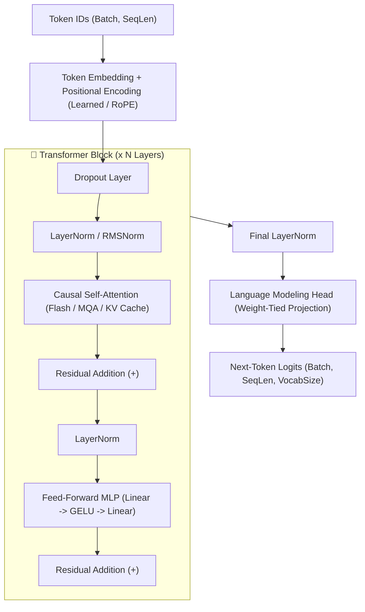

# ⚡ NanoGPT-Core: Modular Autoregressive Transformer from Scratch

[](https://python.org)
[](https://pytorch.org)
[](https://pytorch.org/docs/stable/generated/torch.nn.functional.scaled_dot_product_attention.html)
[](#roadmap)

A clean, modular, and optimized implementation of an **Autoregressive Generative Pretrained Transformer (GPT)** built from fundamental linear algebra and tensor principles in PyTorch. 

Engineered for mechanistic interpretability and pretraining experimentation with modern LLM architectural enhancements: **PyTorch 2.0+ Scaled Dot-Product Attention (SDPA)**, **KV-Caching**, **Rotary Position Embeddings (RoPE)**, **Multi-Query Attention (MQA)**, and **FP16/BF16 Mixed Precision**.

---

## 🏗️ Architecture & Mathematical Foundations



### Key Architectural Components

1. **Causal Multi-Head Self-Attention:**
   $$\text{Attention}(Q, K, V) = \text{softmax}\left(\frac{QK^T}{\sqrt{d_k}} + M\right)V$$
   Where $M$ is a strictly lower-triangular causal attention mask ($M_{ij} = -\infty$ for $j > i$). When possible, natively executes via `torch.nn.functional.scaled_dot_product_attention` for fused kernel hardware acceleration.
2. **Key-Value (KV) Caching:**
   Precomputes and caches past projected Key and Value states during autoregressive generation, dropping inference step complexity from $O(T^2)$ down to $O(1)$ per newly sampled token.
3. **Flexible Positional Encodings:**
   - **Learned Positional Embeddings** (standard GPT-2)
   - **Sinusoidal Positional Embeddings** (Vaswani et al.)
   - **Rotary Position Embeddings (RoPE)** (Su et al. / LLaMA architecture)
4. **Attention Variants:**
   - **Standard MHA:** Independent query, key, value projections per head.
   - **Multi-Query Attention (MQA):** Shared key and value heads across distinct query heads for reduced inference memory footprint.

---

## 📊 Model Scaling Configurations

| Model Preset | Layers | Heads | Embedding Dim | Context Length | Parameter Count |
|---|---|---|---|---|---|
| **Tiny (Demo)** | 4 | 4 | 128 | 128 | ~1.2M |
| **Small** | 6 | 6 | 384 | 256 | ~10.6M |
| **Medium** | 8 | 8 | 512 | 512 | ~25.4M |
| **GPT-2 Base** | 12 | 12 | 768 | 1024 | ~124M |

---

## ✨ Features

- ⚡ **Zero-Dependency Architecture:** Clean, readable PyTorch without bloated third-party frameworks.
- 🚀 **Pretraining Optimizations:**
  - Automatic Mixed Precision (`torch.amp`) for CUDA acceleration.
  - Gradient Accumulation for simulating large batch sizes on single GPUs.
  - Cosine annealing learning rate schedule with linear warmup.
  - Gradient clipping to stabilize pretraining runs.
- 🎯 **Advanced Text Generation:**
  - Temperature scaling (0.1 – 2.0).
  - Top-k truncation filtering.
  - Top-p (Nucleus) probability mass sampling.
  - Autoregressive KV-cache integration.

---

## 🚀 Quick Start

### 1. Installation

```bash
# Clone repository
git clone https://github.com/null-charac69/gpt-from-scratch.git
cd gpt-from-scratch

# Create and activate virtual environment
python -m venv venv
source venv/bin/activate  # Windows: venv\Scripts\activate

# Install dependencies
pip install -r requirements.txt
```

### 2. Run the 60-Second Demo

Trains a tiny model on sample Shakespearean text and verifies generative sampling in under a minute on CPU or GPU:

```bash
python demo.py
```

### 3. Pretraining on Shakespeare Dataset

```bash
python train.py \
    --dataset shakespeare \
    --n_layer 6 \
    --n_head 6 \
    --n_embd 384 \
    --n_positions 256 \
    --batch_size 16 \
    --learning_rate 3e-4 \
    --max_iters 5000 \
    --use_amp
```

### 4. Autoregressive Text Generation

```bash
python generate.py \
    --checkpoint runs/run_YYYYMMDD_HHMMSS/final_model.pt \
    --prompt "To be, or not to be" \
    --max_tokens 150 \
    --temperature 0.8 \
    --top_k 40 \
    --use_cache
```

---

## 📁 Repository Structure

```
gpt-from-scratch/
├── data/
│   ├── dataset.py          # Infinite streaming and tokenized batching
│   ├── tokenizer.py        # Character and subword tokenizer abstractions
│   └── __init__.py
├── model/
│   ├── attention.py        # MHA, MQA, FlashAttention / PyTorch SDPA
│   ├── positional.py       # Learned, Sinusoidal, and Rotary (RoPE) encodings
│   ├── transformer.py      # Pre-LN Transformer blocks with residual connections
│   ├── gpt.py              # Root GPT model with KV-cache generation loop
│   └── __init__.py
├── training/
│   ├── trainer.py          # AMP-enabled training loop and validation routines
│   ├── config.py           # Typed hyperparameters (dataclasses)
│   └── __init__.py
├── utils/
│   └── helpers.py          # LR schedules, device detection, checkpointing
├── demo.py                 # Self-contained end-to-end smoke test script
├── train.py                # CLI pretraining entrypoint
├── generate.py             # Inference & text sampling CLI
└── requirements.txt
```

---

## 🗺️ WIP Roadmap & Future Milestones

- [x] **v0.7 (Current Milestone):** Multi-head causal attention with PyTorch 2.0 SDPA, RoPE position embeddings, KV-caching, mixed precision trainer.
- [ ] **v0.8:** Standalone Byte-Pair Encoding (BPE) tokenizer trainer with byte-level fallback (SentencePiece/tiktoken compatibility).
- [ ] **v0.9:** Low-Rank Adaptation (LoRA) module for parameter-efficient fine-tuning on downstream instructions.
- [ ] **v1.0:** Direct Preference Optimization (DPO) alignment stage for safety and helpfulness tuning.

---

## 📄 License & Author

- **Author:** Anant Thakur ([@null-charac69](https://github.com/null-charac69))
- **License:** MIT
